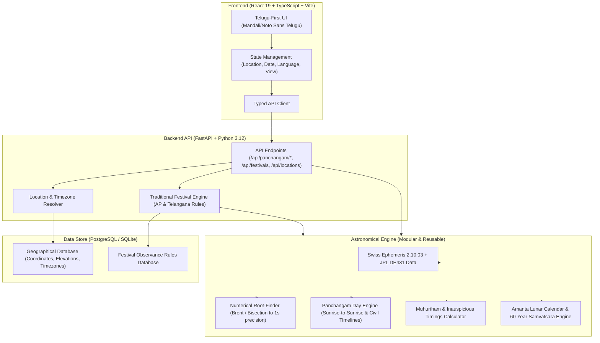

# Telugu Panchangam & Calendar – Architectural Design & Calculation Methodology

## 1. System Overview
This project is an independent, production-grade **Telugu Hindu Calendar & Panchangam platform** (తెలుగు పంచాంగం & క్యాలెండర్). Designed according to classical *Drik Ganita* (astronomical observation-based) principles and modern celestial mechanics, it provides high-precision astronomical calculations, traditional Amanta lunar calendar rules, muhurtham determinations, festival observance engines, and a Telugu-first responsive interface.

---

## 2. Technology Stack & Architectural Decoupling

### Architectural Principles:
1. **Engine Decoupling:** The `astronomical_engine` is a pure Python domain library with zero framework dependencies. It can be packaged as a standalone Python package or embedded directly into Sannivesham or other services.
2. **Astronomical Ephemeris:** Swiss Ephemeris (`swedll64.dll` v2.10.03) powered by high-precision compressed data files (`semo_18.se1` and `sepl_18.se1`) covering 1800 to 2399 CE with NASA JPL DE431 sub-arcsecond accuracy, with automatic fallback to Moshier analytical ephemeris.
3. **Panchangam Day vs. Civil Day:** 
   - Traditional Panchangam day begins at local sunrise ($T_{\text{sunrise}}$) and ends at the subsequent local sunrise ($T_{\text{sunrise+1}}$). The primary Angas of the day are governed by the values prevailing at sunrise.
   - A concurrent civil-date timeline (00:00:00 to 23:59:59 IST) is tracked to clarify midnight transitions.
4. **Time & Coordinate Standardization:**
   - Calculations use UTC Julian Day ($JD_{\text{UT}}$) and Terrestrial Ephemeris Time ($JD_{\text{ET}}$ with $\Delta T$).
   - Coordinates require Latitude ($\phi$), Longitude ($\lambda$), and Elevation ($h$).
   - Output converted to local IANA timezone (`Asia/Kolkata` for India).

---

## 3. Mathematical & Astronomical Calculation Methodology

### 3.1 Ayanamsa (Chitrapaksha / Lahiri)
The Nirayana (sidereal) system is referenced to Spica (Chitra Nakshatra at $180^\circ$ sidereal longitude). We utilize the official Lahiri Ayanamsa (`SE_SIDM_LAHIRI`), standardized by the Indian Calendar Reform Committee (1952).

### 3.2 The Five Angas (పంచాంగం)

| Anga | Sanskrit / Telugu | Celestial Formula | Division / Unit | Total Count |
| :--- | :--- | :--- | :--- | :--- |
| **Tithi** | తిథి | $D = (\lambda_{\text{Moon}} - \lambda_{\text{Sun}}) \pmod{360^\circ}$ | $\lfloor D / 12^\circ \rfloor + 1$ | 30 (1-15 Shukla, 16-30 Krishna) |
| **Vara** | వారం | Solar weekday at sunrise | 1 solar day | 7 (Ravivara to Shanivara) |
| **Nakshatra** | నక్షత్రం | $\lambda_{\text{Moon, sidereal}}$ | $\lfloor \lambda_{\text{Moon, sidereal}} / (360^\circ/27) \rfloor + 1$ | 27 ($13^\circ 20'$ each) |
| **Yoga** | యోగం | $Y = (\lambda_{\text{Moon, sidereal}} + \lambda_{\text{Sun, sidereal}}) \pmod{360^\circ}$ | $\lfloor Y / (360^\circ/27) \rfloor + 1$ | 27 ($13^\circ 20'$ each) |
| **Karana** | కరణం | Half of a Tithi (Elongation $D$) | $\lfloor D / 6^\circ \rfloor$ | 11 (4 fixed + 7 repeating in 8 cycles) |

#### Karana Sequence:
- **Fixed Karanas (స్థిర కరణాలు):**
  1. *Kimstughna (కింస్తుఘ్నం):* First half of Shukla Pratipada ($0^\circ \le D < 6^\circ$).
  2. *Shakuni (శకుని):* Second half of Krishna Chaturdashi ($342^\circ \le D < 348^\circ$).
  3. *Chatushpada (చతుష్పాత్):* First half of Amavasya ($348^\circ \le D < 354^\circ$).
  4. *Naga (నాగవం):* Second half of Amavasya ($354^\circ \le D < 360^\circ$).
- **Repeating Karanas (చర కరణాలు - 7 in 8 cycles = 56 half-tithis):**
  - Sequence: 1: Bava, 2: Balava, 3: Kaulava, 4: Taitila, 5: Gara, 6: Vanija, 7: Vishti (Bhadra).
  - Index for $K \in [1, 56]$: $((K - 1) \pmod 7) + 1$.

### 3.3 Exact Transition Timings via Numerical Root-Finding
Transitions are never approximated by uniform stepping. For any celestial quantity angle $\theta(t)$ and target boundary $B$:
$$f(t) = (\theta(t) - B + 180^\circ) \pmod{360^\circ} - 180^\circ = 0$$
Using Brent's method and continuous bracket narrowing, the exact second $t^*$ of transition is computed where $|f(t^*)| < 10^{-6}$ degrees ($\approx 0.0036$ arcseconds).

### 3.4 Sunrise, Sunset, Moonrise, and Moonset
Calculated topocentrically with atmospheric refraction:
- Standard apparent sunrise/sunset occurs when the Sun's upper limb touches the local horizon.
- Zenith angle: $z = 90^\circ + \text{semi-diameter} (16') + \text{refraction} (34') = 90^\circ 50' = 90.8333^\circ$.
- Swiss Ephemeris `swe_rise_trans` calculates the exact instant for the given geographic latitude, longitude, and elevation.

### 3.5 Muhurtham & Daily Timings
- **Dinamana ($D_m$):** $T_{\text{sunset}} - T_{\text{sunrise}}$.
- **Ratrimana ($R_m$):** $T_{\text{sunrise (next)}} - T_{\text{sunset}}$.
- **Muhurtha length:** Diurnal = $D_m / 15$; Nocturnal = $R_m / 15$.
- **Rahu Kalam, Yamagandam, Gulika Kalam:** Day divided into 8 equal periods of $D_m / 8$.
- **Abhijit Muhurtham:** The 8th diurnal muhurtha ($\text{Sunrise} + 7 \times (D_m/15)$ to $\text{Sunrise} + 8 \times (D_m/15)$). Not observed on Wednesdays.
- **Durmuhurtham:** Specific weekday muhurtha slots:
  - Sunday: 14th
  - Monday: 9th and 12th
  - Tuesday: 4th and 11th
  - Wednesday: 8th
  - Thursday: 6th and 13th
  - Friday: 4th and 9th
  - Saturday: 2nd and 3rd
- **Varjyam & Amrita Kalam:** Nakshatra tyajyam based on classical 60-ghati allocation:
  - Varjyam span is 4 Ghatis ($4/60$ of Nakshatra duration).
  - Starts at Nakshatra-specific ghati (e.g. Ashwini: 50th, Bharani: 24th, Krittika: 30th).
  - Amrita Kalam occurs 14 Ghatis after Varjyam start, lasting 4 Ghatis.
- **Brahma Muhurtham:** 14th nocturnal muhurtha (ends 1 muhurtha before sunrise, from $T_{\text{sunrise}} - 2 \times (R_m/15)$ to $T_{\text{sunrise}} - 1 \times (R_m/15)$).

---

## 4. Telugu Calendar Amanta System & 60-Year Cycle

### 4.1 Amanta Month Determination
In Andhra Pradesh and Telangana, the **Amanta** system is followed:
- A lunar month starts immediately after Amavasya (the exact moment of New Moon conjunction: $\lambda_{\text{Moon}} = \lambda_{\text{Sun}}$).
- The month's name is governed by the **Solar Sankranti** (Sun's ingress into a sidereal zodiac sign) occurring during the lunar month:
  - Sun enters Mesha $\rightarrow$ Chaitramu (చైత్రము)
  - Sun enters Vrishabha $\rightarrow$ Vaishakhamu (వైశాఖము)
  - Sun enters Mithuna $\rightarrow$ Jyeshthamu (జ్యేష్ఠము)
  - Sun enters Karkataka $\rightarrow$ Ashadhamu (ఆషాఢము)
  - Sun enters Simha $\rightarrow$ Shravanamu (శ్రావణము)
  - Sun enters Kanya $\rightarrow$ Bhadrapadamu (భాద్రపదము)
  - Sun enters Tula $\rightarrow$ Ashvayujamu (ఆశ్వయుజము)
  - Sun enters Vrischika $\rightarrow$ Karthikamu (కార్తీకము)
  - Sun enters Dhanu $\rightarrow$ Margashiramu (మార్గశిరము)
  - Sun enters Makara $\rightarrow$ Pushyamu (పుష్యము)
  - Sun enters Kumbha $\rightarrow$ Maghamu (మాఘము)
  - Sun enters Meena $\rightarrow$ Phalgunamu (ఫాల్గుణము)
- **Adhika Masam (అధిక మాసం):** When a lunar month contains NO solar Sankranti (the Sun does not change signs between consecutive Amavasyas), that month is an *Adhika Masam* bearing the name of the upcoming natural month.
- **Kshaya Masam (క్షయ మాసం):** When two solar Sankrantis occur within a single lunar month.

### 4.2 60-Year Samvatsara Cycle (షష్టి సంవత్సరాలు)
Begins on Chaitra Shukla Pratipada (Ugadi). Cycles through 60 names from Prabhava (1) to Kshaya (60).
- Example: 2024-2025 CE corresponds to **Krodhi** (క్రోధి, #38).
- 2025-2026 CE corresponds to **Vishvavasu** (విశ్వావసు, #39).
- 2026-2027 CE corresponds to **Parabhava** (పరాభవ, #40).

---

## 5. Dharmashastra Vyapti Engine & Festival Determination

Traditional Hindu festivals are governed by precise astronomical conditions (Tithi/Nakshatra during specific periods of the day) according to *Dharma Sindhu* and *Nirnaya Sindhu*.

### 5.1 Observance Windows (Karma Kala)
The day is divided into distinct canonical observance windows:
1. **Sunrise (Udayavyapini / Ahoratra):** From $T_{\text{sunrise}}$ to 1 muhurtha post-sunrise.
2. **Madhyahna:** The 3rd fifth of the daytime ($T_{\text{sunrise}} + 0.4 \times \text{Dinamana}$ to $T_{\text{sunrise}} + 0.6 \times \text{Dinamana}$, $\approx$ 11:30 AM to 1:45 PM). Used for Sri Rama Navami and Vinayaka Chavithi.
3. **Sayahna:** The 5th fifth of the daytime ($T_{\text{sunrise}} + 0.8 \times \text{Dinamana}$ to $T_{\text{sunset}}$). Used for Narasimha Jayanti and Saddula Bathukamma.
4. **Pradosha:** 3 muhurthas ($\approx$ 2h 24m) from sunset ($T_{\text{sunset}}$ to $T_{\text{sunset}} + 0.2 \times \text{Ratrimana}$). Used for Deepavali Lakshmi Puja, Karthika Purnima, Holi Kamadahana, and Ksheerabdhi Dwadashi.
5. **Nishita:** The 8th muhurtha of the night, centered at local midnight ($T_{\text{sunset}} + \frac{7}{15} \times \text{Ratrimana}$ to $T_{\text{sunset}} + \frac{8}{15} \times \text{Ratrimana}$). Used for Maha Shivaratri (Lingodbhava) and Krishna Janmashtami.
6. **Arunodaya:** 4 ghatis = 2 muhurthas of the night before sunrise ($T_{\text{sunrise}} - \frac{2}{15} \times \text{Ratrimana}$ to $T_{\text{sunrise}}$, nominally 96 minutes before sunrise). Used for Naraka Chaturdashi, Ratha Saptami, and Vaikuntha Ekadashi.
7. **Aparahna:** The 4th fifth of the daytime ($T_{\text{sunrise}} + 0.6 \times \text{Dinamana}$ to $T_{\text{sunrise}} + 0.8 \times \text{Dinamana}$). Used for Vijaya Dashami (Dasara), Mahalaya Amavasya, and Raksha Bandhan (Upakarma).

### 5.2 Canonical Single-Day Resolution
To prevent festivals from appearing on multiple days, the engine computes the exact overlap in seconds of the target tithi in the specified Karma Kala window for $\text{Day}_i$, $\text{Day}_{i-1}$, and $\text{Day}_{i+1}$.
$$\text{Observed}(\text{Day}_i) \iff \text{Overlap}(\text{Day}_i) \ge \text{Overlap}(\text{Day}_{i-1}) \land \text{Overlap}(\text{Day}_i) > \text{Overlap}(\text{Day}_{i+1})$$
If both days share identical overlap, the *Purvaviddha* rule awards it to Day 1, strictly eliminating Day 2.

### 5.3 Special Ingress & Lunar Rules
- **Makara Sankranti Post-Sunset Rollover:** If the Sun crosses 270° sidereal longitude after sunset, the Punya Kala and festival observance shifts to the next day. Bhogi (1 day before), Kanuma (1 day after), and Mukkanuma (2 days after) shift in exact unison.
- **Varalakshmi Vratam:** Evaluated on the Friday preceding (or on) Shravana Purnima.
- **Sankashtahara Chaturthi:** Evaluated at the exact moment of Moonrise ($T_{\text{moonrise}}$).
- **Deduplication:** Generic `purnima_vratam` and `amavasya_vratam` entries are automatically suppressed when a specific festival (e.g. Holi, Hanuman Jayanti, Karthika Purnima, Deepavali) is present on that day.

---

## 6. Muhurtha & Classical Inauspicious Timings

All daily timings are derived from topocentric diurnal and nocturnal muhurtha calculations:
- **Rahu Kalam, Yamagandam, Gulika Kalam:** 1/8th divisions of daytime based on weekday ruler. In Telugu and South Indian Jyotish, **Gulika Kalam is classified as strictly inauspicious (అశుభ సమయం)**.
- **Saturday Durmuhurtham:** Defined according to *Muhurtha Chintamani* as the 1st and 2nd Muhurthas right from sunrise (`[1, 2]`), spanning a continuous 1h 36m.
- **Amrita Kalam:** Calculated using canonical 27-Nakshatra starting ghatis from *Muhurtha Chintamani* (not a fixed +14 ghati offset). Lasts for 4 ghatis ($4 \times \text{NakshatraDuration}/60$).
- **Varjyam:** Calculated using classical starting ghatis (e.g. Hasta at 22nd ghati).
- **Day Boundary Window:** Both Varjyam and Amrita Kalam are strictly constrained to $[T_{\text{sunrise}}, T_{\text{next\_sunrise}}]$, with natural 0-window or 2-window days handled gracefully.

---

## 7. Verification Strategy & Multi-Platform Architecture

- **Cross-Platform C-ABI:** Multi-platform library loader supporting Windows `swedll64.dll`, Linux `libswe.so`, and macOS `libswe.dylib`.
- **Automated Test Suite:** 24 comprehensive test cases covering Lahiri Ayanamsa, 30-day continuous monotonicity, root-finding convergence, festival single-day exclusivity, December Pushya Samvatsara, and post-sunset Sankranti rollovers. All 24 tests pass 100%.
